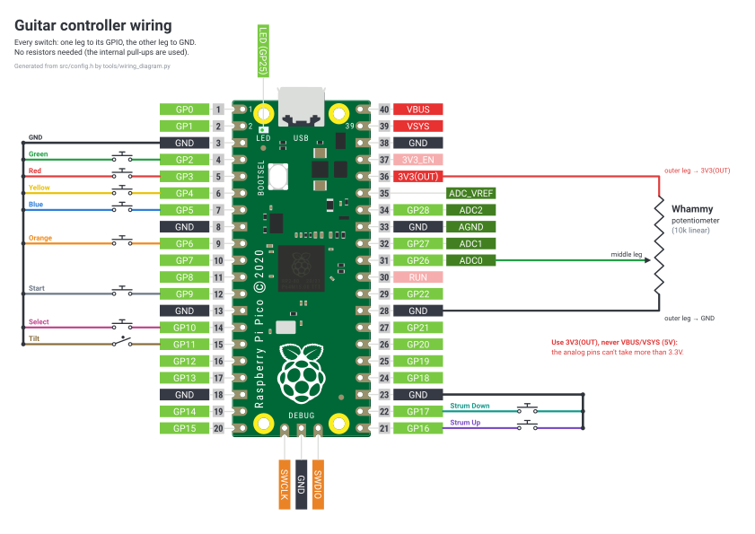

# RP2040 Guitar Controller

Firmware for a DIY rhythm-game guitar controller on an RP2040 (Raspberry Pi Pico or similar).
It shows up on a computer as a standard **USB gamepad**, so it works with PC rhythm games
like **Clone Hero** and **YARG** without drivers.

## What a guitar controller has

| Control | What it is | How the game uses it |
|---|---|---|
| 5 fret buttons | Green, Red, Yellow, Blue, Orange on the neck | Hold the fret(s) matching the note… |
| Strum bar | A rocker with two switches (up and down) | …and strum to play it. Either direction counts. Also used to scroll menus |
| Start | Button on the body | Pause / confirm |
| Select | Button on the body, a.k.a. "Star Power" | Activates star power / back |
| Tilt sensor | Tilt switch inside the body | Point the neck up to activate star power |
| Whammy bar | A lever on a potentiometer | Bends sustained notes; fills the star power meter |

Real store-bought guitars also have a D-pad and a Guide/Home button. You can add those
as extra buttons if you want them, but games don't need them.

## What it reports as (and why)

It's a generic HID gamepad with **16 buttons and 2 axes**:

- Buttons 1–10: green, red, yellow, blue, orange, strum up, strum down, start, select, tilt
  (the order of the list in `src/config.h`)
- X axis: whammy
- Y axis: analog tilt (off by default)

The first time you play, you bind each button in the game's controller settings.
Clone Hero and YARG both support this. Copying a specific commercial guitar's USB IDs
would let some games detect it automatically, but generic is simpler, works everywhere,
and you can see exactly what it sends.

The USB connection also carries a **serial port** for debug messages, and a reset
interface so VS Code can reflash the board without you pressing BOOTSEL.

## Wiring (defaults)



Every switch goes between its GPIO and **GND**. No resistors needed because the internal pull-ups are used.

This picture shows the **default** pins. If you change pins in `src/config.h`, draw an
up-to-date version with the command below and open `docs/wiring.svg`:

```
python3 tools/wiring_diagram.py
```

| Control | GPIO |
|---|---|
| Green | GP2 |
| Red | GP3 |
| Yellow | GP4 |
| Blue | GP5 |
| Orange | GP6 |
| Strum up | GP16 |
| Strum down | GP17 |
| Start | GP9 |
| Select / Star Power | GP10 |
| Tilt switch | GP11 |
| Whammy pot (middle leg) | GP26. Outer legs go to **3V3** (pin 36) and **GND**. |

Use **3V3, not VBUS/5V**, for the pot. The ADC pins can't handle 5V.
Any switch that isn't wired yet just reads as "not pressed".

## Build and flash

1. Open this folder in VS Code with the **Raspberry Pi Pico** extension installed.
   The `.vscode/` folder points it at the SDK 2.3.1 / toolchain 15_2_Rel1 that the extension installs.
   If the extension can't find them (e.g. on another computer with different versions), use
   **Pico sidebar → Import Project** and pick this folder to regenerate it.
2. **First flash:** hold BOOTSEL while plugging the board in, then click **Run**.
   You can also drag `build/guitar.uf2` onto the `RPI-RP2` drive that appears.
3. After that, **Run** reboots and reflashes it automatically.

If you're not using a plain Pico, change `PICO_BOARD` in `CMakeLists.txt`.

## Testing

1. Open the **Serial Monitor** (VS Code, bottom panel) on the board's port. Press buttons and
   you'll see lines like `buttons: green strum_down | whammy 0 (raw 12)`. The onboard LED
   also lights while any button is held.
2. Check that the computer sees it as a gamepad:
   - Windows: Win+R → `joy.cpl` → *RP2040 Guitar* → Properties
   - Linux: `jstest-gtk` or `evtest`
   - Any OS: a browser gamepad tester page
3. In Clone Hero / YARG, add the controller and bind each control.

## Customizing: edit `src/config.h`

- **Pins / which buttons exist:** edit the `GUITAR_BUTTONS` list. Order = button number.
- **Whammy range:** move the whammy end to end, read the `raw` values in the serial
  monitor, and put them in `WHAMMY_RAW_MIN` / `MAX` (swap them if it works backwards).
- **Double-presses / chattering:** raise `DEBOUNCE_MS`.

## Code map

| File | What's in it |
|---|---|
| `src/config.h` | Pins and settings. Start here |
| `src/main.c` | Main loop: read inputs, send a report when something changes |
| `src/inputs.c` | Switch reading with debouncing, analog reading with smoothing |
| `src/usb_descriptors.c` | How the board describes itself over USB, including the report layout |
| `src/tusb_config.h` | TinyUSB (USB library) settings |
| `tools/wiring_diagram.py` | Draws `docs/wiring.svg` from `config.h` on top of `pico-pinout.svg` |

The Pico pinout artwork (`pico-pinout.svg`) is by Raspberry Pi Ltd.

## Ideas for later

- **Accelerometer tilt** (e.g. an I²C IMU) instead of a tilt switch
- **XInput mode**, so Windows treats it like an Xbox 360 guitar with no binding needed
  (a bigger project, since XInput isn't HID)
- **LEDs** on the frets or a star power indicator
